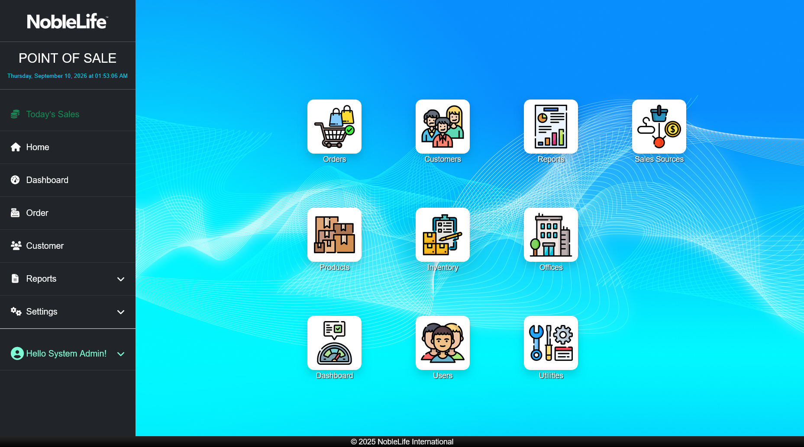
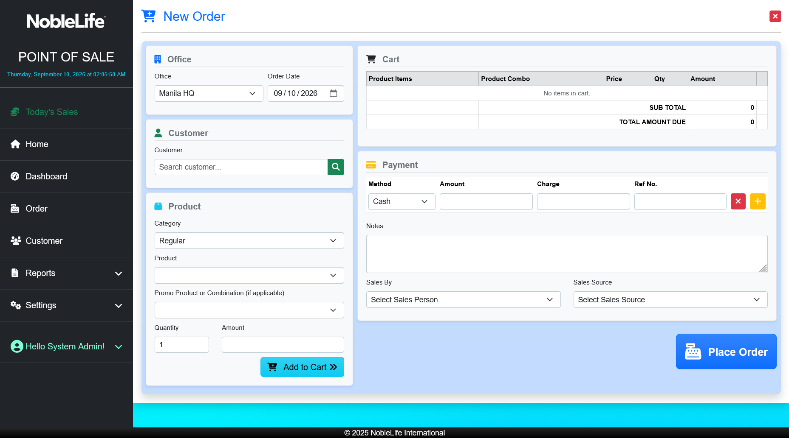
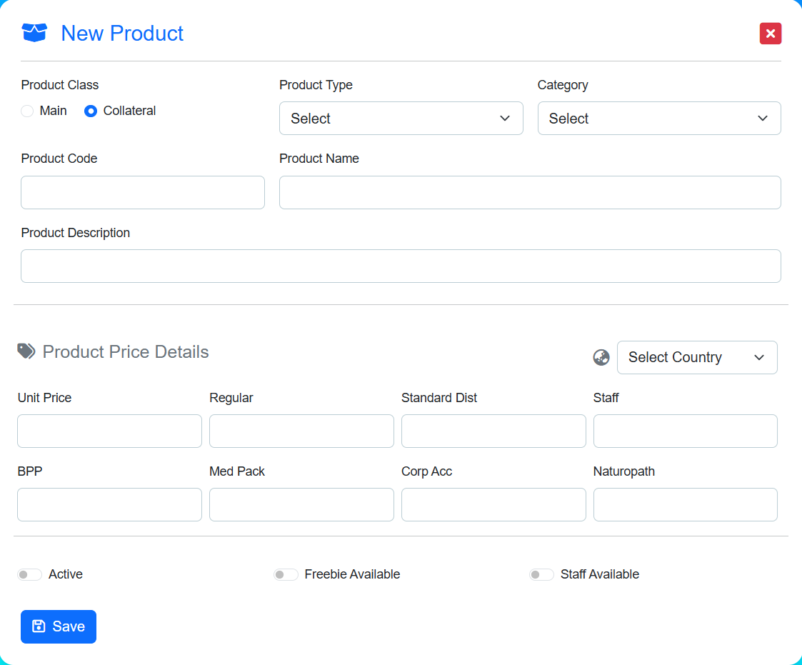
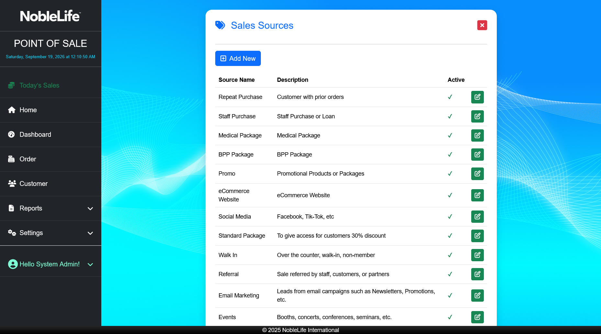

# NLI-POS User's Guide

Use this guide to process sales and manage customers, products, inventory, reports, and user access in NLI-POS. The guide describes the screens and actions currently available in the application.

## Table of contents

1. [Introduction](#1-introduction)
2. [Getting Started](#2-getting-started)
3. [Daily Operations](#3-daily-operations)
4. [Product and Inventory Management](#4-product-and-inventory-management)
5. [Customer Management](#5-customer-management)
6. [Reports](#6-reports)
7. [User and Role Management, Settings](#7-user-and-role-management-settings)
8. [Troubleshooting and FAQ](#8-troubleshooting-and-faq)
9. [Glossary](#9-glossary)
10. [Missing screenshots](#10-missing-screenshots)

## 1. Introduction

NLI-POS is a browser-based point-of-sale and back-office application. You can record customer orders and payments, maintain customer and product records, track stock across locations, and review sales reports.

The application uses roles and office access to control which pages and records you can use. Your actual access depends on the account configured for you.

| User type | Typical work in the application |
| --- | --- |
| Cashier or customer-service staff | Enter orders, take payment, view receipts, and look up customers, if assigned the required access. |
| Store manager | Review dashboard figures and reports, and oversee sales and stock. The base application does not define a separate **Manager** role; an administrator assigns the required roles and office access. |
| Inventory staff | Review stock, record stock changes, move stock between locations, and review inventory transactions. |
| Accounting staff | Review sales and pricing information and reports. |
| Administrator | Manage user access, offices, products, inventory, payment methods, lookup lists, audit logs, and data utilities. |

The roles configured by the application include **Admin**, **CS**, **Accounting**, and **Inventory**. Your administrator can tell you which role applies to your job and which offices you can use.

## 2. Getting Started

### System requirements

- Use a current web browser supported by your organization.
- Connect to your store's network or the approved network where NLI-POS is hosted.
- Ask your administrator for the correct NLI-POS web address and your account credentials.
- The application does not document minimum browser versions or special client hardware. Printing uses the browser's print function.

### Sign in

1. Open the NLI-POS web address provided by your administrator. **Expected result:** The sign-in page appears.
2. Enter your account email in **Email**.
3. Enter your password in **Password**.
4. Select **Remember me?** only if this is a trusted, private device.
5. Select **Log In**. **Expected result:** The application opens the home page or the page you were trying to access.

*Figure: Sign in with the email and password issued for your account.*

If you cannot sign in, check that you are using the right web address and account details. Use **Forgot your password?** if it is available for your account, or ask your administrator for help.

### First-time setup

An administrator prepares the store before cashiers begin entering sales.

1. Ask your administrator to confirm that your account is active and has the correct role.
2. Ask your administrator to assign the office or offices where you work.
3. Ask your administrator to confirm that products, prices, stock, customer classes, and payment methods are available for your office.
4. Open the account menu and select **Manage Account** to review your profile.
5. If you need to change your password, open **Manage Account**, select **Password**, enter your current and new passwords, and select **Update password**. **Expected result:** A status message confirms whether the password was updated.

### Navigate the interface

The left navigation is available after you sign in. On smaller screens, open the **Menu** panel to see it.

- **Home** shows shortcuts to common areas.
- **Dashboard** shows sales figures and charts. Use **Office**, **Start Date**, and **End Date**, then select **Apply Filters** to change the view.
- **Order** opens order search and entry.
- **Customer** opens customer records.
- **Reports** contains **Daily Sales**, **Sales by Date Range**, **Monthly Sales**, **Order Details**, and **Sales Quota**.
- **Settings** is shown to administrators and contains user, office, product, inventory, and utility pages.
- The signed-in user menu contains **Manage Account** and **Logout**.
- **Today’s Sales** opens a quick sales summary.

*Figure: The home page provides shortcuts to the main work areas.*

*Figure: The dashboard displays sales indicators, charts, and date and office filters.*

## 3. Daily Operations

### Opening or closing a shift or cash drawer

NLI-POS does not provide a shift-opening, cash-drawer count, or shift-closing workflow. It does not record a drawer opening balance or a counted closing balance. Use your store's separate cash-handling procedure. For sales totals in NLI-POS, use **Reports** > **Daily Sales**.

### Make a sale

1. Select **Order** in the navigation. **Expected result:** The Orders list opens.
2. Select **New Order**. **Expected result:** The order-entry form appears.
3. Choose the correct **Office** and **Order Date**.
4. Select the customer using **Search Customer**. In the search window, search by name, customer ID, email, or mobile number, then choose the matching customer. **Expected result:** The customer's name and class appear on the order.
5. If the customer is not listed, select **New Customer**, complete the required fields, and save the record. Return to the order and select the new customer.
6. Choose a **Category**: **Regular**, **Promo/Package**, or **Freebie**.
7. Select the **Product**. For a package, select its **Promo Product or Combination (if applicable)**. **Expected result:** The form displays the selected product and its available price.
8. Enter the **Quantity** and select **Add to Cart**. **Expected result:** The item appears in **Cart**, and the total updates.
9. Repeat the product selection and add-to-cart steps for each item.
10. In **Payment**, choose a **Method**, enter the amount, and enter a **Ref No.** when required by the payment method.
11. Use the add-payment control to add another payment row when the customer pays with more than one method. **Expected result:** Each tender appears as a separate payment line.
12. Select the required **Sales By** person. Add **Sales Source** or **Notes** when needed.
13. Check that the total amount entered in **Payment** is at least the displayed **Total Amount Due**. **Expected result:** The form accepts the payment total; it will not place an order when payment is short.
14. Select **Place Order**, then confirm the prompt. **Expected result:** The order is saved, a receipt is available from its details, and stock is reduced for the items sold.

*Figure: Enter the office, customer, products, quantities, and payment on the New Order form.*

*Figure: The Orders list lets you find transactions by office and search text.*

The Orders list has an office filter, search, and **Export Excel**, **Export CSV**, and **Export PDF** actions.

*Figure: A sale can use more than one payment method and include payment reference numbers.*

**Note:** Prices are provided by the product and customer-class setup. Package or promotional prices are selected as products; the order form does not provide a general manual discount or tax-entry field. A payment method may have a configured service charge; review the charge shown on the payment row before placing the order.

### View, print, or email a receipt

1. Select **Order** and find the transaction in the Orders list. Use the office selector or search box if needed.
2. Open the order's details using its action button. **Expected result:** The Order Details page shows the customer, items, totals, and payment summary.
3. Select **View Receipt**. **Expected result:** The receipt opens in a window.
4. Select **Print** to open your browser's print dialog, then choose an available printer and print settings. **Expected result:** The browser sends the receipt to the selected printer.
5. Select **Email**, enter the recipient's email address when prompted, and confirm. **Expected result:** The page reports whether the email was sent.
6. To print the receipt again later, reopen a non-void order's details and repeat the receipt and print steps.

*Figure: Order Details includes the receipt and void actions for an active order.*

*Figure: The receipt preview provides Print and Email actions.*

### Void an order

NLI-POS provides **Void Order**; it does not provide a separate returns or refund transaction.

1. Open **Order** and find the order.
2. Open its details and verify that it is the correct transaction.
3. Select **Void Order** and confirm the prompt. **Expected result:** The order is marked void, and its sold stock is returned to inventory.

**Warning:** Voiding changes the transaction and stock records. Confirm the order and follow your store's approval procedure before you void it. The application does not provide a separate refund workflow or an unvoid action; process any money returned to the customer according to your store's payment-provider procedure.

### Hold or recall a transaction

The order-entry screen has no **Hold**, **Recall**, or held-orders list. Do not rely on NLI-POS to save an unfinished transaction for another cashier or shift. Complete the sale, or follow your store's procedure for an unfinished checkout.

## 4. Product and Inventory Management

Access to product and inventory pages depends on your role and office access.

### Add or update a product

1. Open **Settings** > **Products**. **Expected result:** The product list opens.
2. Select **Add New** to create a product, or select the edit action beside an existing product. **Expected result:** The product form opens.
3. Choose the **Product Class**, **Product Type**, and **Category**.
4. Enter the **Product Code**, **Product Name**, and any description.
5. Choose the price country and enter the applicable price fields, such as **Regular**, **Standard Dist**, **Staff**, **BPP**, or **Med Pack**.
6. Set the **Active**, **Freebie Available**, and **Staff Available** options as appropriate.
7. Select **Save**. **Expected result:** The product or product changes are saved and the product appears in the catalog.

The product list also provides **Copy**, **CSV**, **Excel**, **PDF**, and **Print** actions.

*Figure: Search and review product codes, names, classes, types, categories, and active status.*

*Figure: Product Details shows product information, pricing, and availability.*

*Figure: The New Product form captures product classification, prices, and availability.*

*Figure: Product details include price information and any configured product combinations.*

The product **Category** includes regular products, **Promo/Package**, and **Freebie**. Package products can have one or more product combinations. Their component products and quantities are used when the package is sold.

*Figure: A package product can have combinations and promo settings.*

### Review and update stock

1. Open **Settings** > **Inventory**. **Expected result:** The inventory area opens.
2. Choose **Warehouse**, **Stockroom**, or **Offices** in the inventory navigation.
3. Choose a location and review **Main Products** or **Marketing Collateral**. **Expected result:** The table shows the available stock and, where displayed, its minimum level.
4. To record stock, select **Add New**, choose the **Location** and **Product**, enter **Stock Quantity** and **Minimum Level**, add **Remarks** if needed, and select **Save**. **Expected result:** The selected location's stock record is updated.
5. To edit an existing stock record, select its edit action, update **Stock Quantity**, **Minimum Level**, or **Remarks**, and select **Save**. **Expected result:** The stock table reflects the saved values.

Inventory tables also provide **Copy**, **CSV**, **Excel**, **PDF**, and **Print** actions, plus search where available.

*Figure: Warehouse inventory shows stock levels and actions for each product.*

*Figure: Stockroom inventory displays stock for the selected stockroom.*

*Figure: Office inventory shows stock by office and product class.*

*Figure: Record a location, product, stock quantity, minimum level, and remarks.*

### Transfer stock between locations

1. Open the relevant inventory list and select the product's transfer action. **Expected result:** The Stock Transfer form opens with the selected product.
2. Choose the **From** and **To** locations.
3. Enter the **Quantity** and any **Remarks**.
4. Select **Transfer**. **Expected result:** Stock moves from the source location to the destination location and the transfer is recorded.

*Figure: Select source and destination locations and enter the transfer quantity.*

### Maintain inventory locations

1. Select **Locations** in the inventory navigation. **Expected result:** The Inventory Locations list shows each location's name, type, office, and status.
2. Select **New Location** or the edit action for a location.
3. Enter the **Name**, choose a **Location Type**, and optionally select an **Office**.
4. Select **Save**. **Expected result:** The location appears in the list.
5. Use the status action to activate or deactivate a location, then confirm. **Expected result:** Its status changes in the list.

*Figure: Inventory Locations lists warehouses, stockrooms, and office locations.*

### Review inventory transactions and conversion rules

1. Select **Transactions** in the inventory navigation. **Expected result:** The transaction history lists date, type, product, locations, quantity, and user.
2. Search or sort the history to find a stock movement. **Expected result:** Matching transaction rows remain visible.

*Figure: Transaction History records inventory movements and the user who entered them.*

To manage product conversions, select **Conversion** in the inventory navigation. Add or edit a rule by choosing **From Product**, **To Product**, and the conversion **Quantity**, then select **Save**. A conversion rule defines how many units of one product correspond to the other product.

*Figure: Conversion settings list the configured product conversion rules.*

*Figure: Enter the source product, destination product, and conversion quantity.*

## 5. Customer Management

### Find a customer

1. Select **Customer** in the navigation. **Expected result:** The Customers list opens.
2. Enter a name or other search text in **Search...**, or choose a country from the country filter. **Expected result:** The list narrows to matching customers.
3. Select the customer details action to review the record. **Expected result:** The customer profile opens.
4. Select **Customer Information** or **Order History** to review the profile or its recorded orders.
5. Select **Export All to Excel** to download the customer list for the selected country. **Expected result:** The filtered customer data downloads as a spreadsheet.

*Figure: Search and filter customer records from the Customers list.*

*Figure: Customer Details includes the customer's information and order history.*

### Add a customer

1. In **Customer**, select **New Customer**. **Expected result:** The Customer Registration form opens.
2. Choose **Customer Class** and **Office**.
3. Enter the required personal details: **First Name**, **Last Name**, **Gender**, **Birthday**, and **Civil Status**.
4. Choose **Country** and enter any available contact and address details.
5. Select **Save**. **Expected result:** The customer is saved and can be selected for an order.

*Figure: Customer Registration includes required identity, class, office, and country fields.*

During checkout, the **Search Customer** window can also create a customer using **New Customer**.

*Figure: Search by customer name, ID, email, or mobile number and select the matching record.*

Use the customer list's edit and details actions to maintain existing profiles. Deletion is controlled by the permissions assigned to your account.

## 6. Reports

### Dashboard

The **Dashboard** includes today's total sales, order count, and average order value, plus charts and lists for sales trends, products, salespeople, customers, staff purchases, and payment methods. Choose an **Office**, **Start Date**, and **End Date**, then select **Apply Filters**. Use the chart controls to change the product category or comparison period where shown.

### Daily Sales

1. Open **Reports** > **Daily Sales**.
2. Choose an **Office** and **Date**.
3. Select **Filter**. **Expected result:** The report shows matching sales as product and order detail rows.
4. Read the totals at the bottom of the table. Use the order number, customer, product, quantity, payment method, and reference columns to reconcile individual sales.

*Figure: Daily Sales filters and transaction-line results.*

### Sales by Date Range

1. Open **Reports** > **Sales by Date Range**.
2. Choose an **Office**, **Date From**, and **Date To**.
3. Select **Filter**. **Expected result:** The table shows sales lines for the selected office and dates.
4. Review the order, customer, product, quantity, amount, payment, and encoding columns to investigate a total.

*Figure: Sales by Date Range report with an office and date range selected.*

### Monthly Sales

1. Open **Reports** > **Monthly Sales**.
2. Choose an **Office**, **Month**, and **Year**.
3. Select **Filter**. **Expected result:** The monthly sales report displays the results for the selected period.
4. Select **Export to Excel** if you need a spreadsheet copy of the displayed report.

*Figure: Monthly Sales report with its office, month, and year filters.*

### Order Details

1. Open **Reports** > **Order Details**.
2. Choose an **Office**, **Month**, and **Year**, then select **Filter**. **Expected result:** The **Purchases** list shows orders for the selected period and the first available order's details appear.
3. Select an order in **Purchases**. **Expected result:** Its customer, date, remarks, products, quantities, and total appear in **Details**.
4. Select **Export to Excel** when you need the filtered report as a spreadsheet.

*Figure: Select an order in Purchases to inspect its details and line items.*

### Sales Quota

1. Open **Reports** > **Sales Quota** and choose an **Office**. **Expected result:** The quota list shows salesperson results for that office.
2. Select **Add Sales Quota** to create a quota, or select the edit action on a row to change one.
3. Choose the **Salesperson**, **Year and Month**, and enter the **Quota Amount**.
4. Select **Save Quota**. **Expected result:** The quota list shows the salesperson's daily sales, month-to-date sales, quota, variance, and achieved percentage.

*Figure: Sales Quota shows the target and sales progress for each salesperson.*

There is no separate end-of-day cash-drawer or shift-close report in the application. Use **Daily Sales** for sales recorded in NLI-POS; use your store's cash-count procedure for drawer reconciliation.

## 7. User and Role Management, Settings

**Settings** is an administrator area. If you cannot see it or a setting is unavailable, ask an administrator rather than using another person's account.
The **Settings** menu is shown to administrators. Some product and inventory pages also grant access to other roles; your administrator can confirm how to open those pages for your account.

### Manage users, roles, and office access

1. Open **Settings** > **Users**. **Expected result:** The user list shows each account, default office, and active status.
2. Select **Register** to create a user account. **Expected result:** The account registration form opens.
3. Select **Manage Access** for a user to review the available roles and the **Add**, **Edit**, **Delete**, and **View** access switches.
4. Turn on only the required roles and permissions. **Expected result:** The selected roles and access settings are ready to save.
5. Select **Save**. **Expected result:** The user's assigned access is updated.
6. Select **Manage Office Access** to review or add the offices the user may access. **Expected result:** The list shows the user's assigned offices.
7. Use **Deactivate User** or **Activate User** as appropriate. **Expected result:** The account's active status changes.

*Figure: The Users list provides registration, account, role-access, and office-access actions.*

*Figure: Administrators assign roles and add, edit, delete, or view access.*

*Figure: An administrator can review and add a user's office access.*

### Manage your account

1. Open the signed-in user menu and select **Manage Account**. **Expected result:** Your profile settings open.
2. Update your available profile information and select **Save**.
3. Select **Email** or **Password** in the account navigation to manage those settings. **Expected result:** The relevant account form opens.
4. Select **Logout** when you finish using a shared device.

*Figure: Manage Account provides profile, email, and password sections.*

### Maintain offices and reference lists

In **Settings**, administrators can maintain **Offices**, **Products**, **Sales Sources**, and **Inventory**. The **Utilities** submenu contains **Countries**, **Payment Methods**, **Customer Classes**, **Product Types**, **Background**, **Themes**, **Audit Logs**, and **Backup**.

- Use **Offices** to maintain office information, including its country and active status. Office settings also determine the currency, locale, and time zone used on relevant screens.
- Use **Payment Methods** to add or edit a method, its description, **Service Charge (%)**, and **Active** status. Only active methods are offered during order entry.
- Use **Customer Classes** and product price fields to maintain customer-specific pricing.
- Use **Product Types**, **Countries**, and **Sales Sources** to maintain the corresponding choices shown in forms.
- Use **Background** to choose an application background and **Themes** to choose **Default**, **Pulse**, **Flatly**, or **Lumen**.
- Use **Audit Logs** to review recorded activity.
- Select **Backup** to open **Export Table to CSV**. Choose a table in **Select a table:** and select **Export CSV**. **Expected result:** The selected table downloads as a CSV file.
- A separate admin-only **Database Backup** page provides **Backup Now** and **Download Backup** after a backup is created. It is not linked from the current sidebar; ask your administrator if you need to use it.

*Figure: Administrators can maintain active sales sources used when recording an order.*

*Figure: Office records define the locations and regional settings available in the application.*

*Figure: Payment Methods include a name, service charge rate, and active status.*

*Figure: Utilities include lookup lists, appearance options, audit logs, and data tools.*

The current order form does not expose tax configuration, receipt-format settings, or a printer-setup page. It uses the receipt format provided by the application and the browser print dialog.

## 8. Troubleshooting and FAQ

| Message or problem | What to do |
| --- | --- |
| “Please select a customer.” | Choose a customer before you select **Add to Cart**. |
| “Please select a product.” | Choose a product in **Product** before selecting **Add to Cart**. |
| “Please select a promo product or combination.” | For a **Promo/Package** sale, select an option under **Promo Product or Combination (if applicable)**. |
| “Price is not set for this product.” | Ask an administrator to review the product price for the selected customer class and country. |
| “Not enough stock” or a package-component stock warning | Check the stock for the selected office and location. Reduce the quantity or ask inventory staff to correct the stock record. |
| “Total paid … is less than order total …” | Add or correct payment rows until the total entered is at least **Total Amount Due**. |
| “Please select a Sales Person before placing the order.” | Choose a value in **Sales By**, then place the order again. |
| Required-field validation appears on Customer Registration | Complete the fields marked required, including customer class, office, first and last name, gender, birthday, civil status, and country. |
| A page is missing or access is denied | Ask an administrator to check your role, active account status, and office access. |
| A report is empty | Check the selected office and date/month filters, then select **Filter** again. |
| Receipt email reports an error | Check the recipient address and ask your administrator whether receipt email service is available. You can use **Print** as an alternative. |
| The page appears to keep loading or results do not update | Check your network connection, refresh the page, and repeat the action. If it continues, report the page and message to your administrator. |

**FAQ: Can I put an order on hold and finish it later?**
No. The application does not provide a hold-and-recall workflow.

**FAQ: Can I record a refund or product return?**
No. The available order action is **Void Order**. Follow your store's refund procedure separately.

**FAQ: Where do I count or close the cash drawer?**
NLI-POS does not track drawer counts or shift opening and closing. Use your store's separate cash-handling procedure.

**FAQ: Can I add a discount or tax to an order?**
The order-entry screen has no general discount or tax field. Product prices and configured package pricing determine the displayed amounts.

## 9. Glossary

| Term | Meaning in NLI-POS |
| --- | --- |
| Office | A store or branch selected when entering orders and filtering information. |
| Customer class | A customer category used with product price setup. |
| Product class | The product grouping **Main** or **Collateral**. |
| Category | A sale/product grouping such as **Regular**, **Promo/Package**, or **Freebie**. |
| Combination | A configured set of component products used by a package. |
| Payment method | The configured tender type selected on an order, such as cash or another enabled method. |
| Service charge | A charge rate configured for a payment method and displayed on its payment row when applicable. |
| Sales source | The recorded source or reason for a sale, chosen from the configured list. |
| Void | A status applied to an order using **Void Order**; the application restores the sold stock. |
| Stockroom / warehouse | Inventory locations used to organize stock. |
| Conversion rule | A configured relationship between a source product, destination product, and quantity. |
| Minimum level | A stock threshold recorded for a product at a location. |
| Office access | The list of offices a user account is allowed to work with. |

## 10. Missing screenshots

The following image links are intentional placeholders until screenshots of these screens are added:

- Daily Sales report
- Sales by Date Range report
- Monthly Sales report
- Sales Quota report
- Sign-in page
- Sales dashboard
- Orders list, order details, payment lines, and receipt
- Product list, details, editing, and product combinations
- Warehouse, stockroom, and office inventory
- Adding stock, stock transfers, transaction history, and product conversions
- Customer list, details, and search
- Order Details report
- Users list, role access, office access, and account profile
- Office settings
- Payment Method settings
- Administrator utilities
