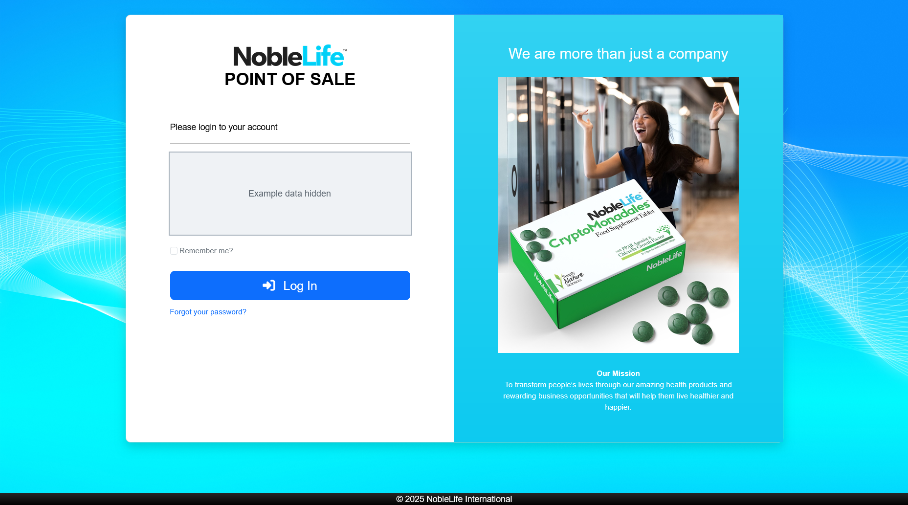
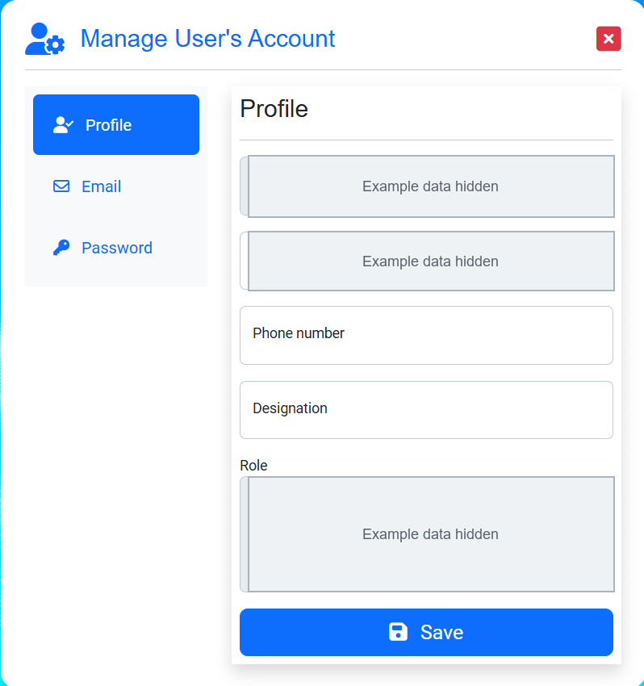

# Getting Started

Use a current web browser on your organization's approved network. Ask your administrator for the NLI-POS web address and the account credentials issued to you.

## Sign in

1. Open the NLI-POS web address provided by your administrator. **Expected result:** The sign-in page appears.
2. Enter your account email in **Email**. **Expected result:** Your email appears in the field.
3. Enter your password in **Password**. **Expected result:** Your password is hidden in the field.
4. Select **Remember me?** only on a trusted, private device. **Expected result:** The app may remember your sign-in on this device.
5. Select **Log In**. **Expected result:** The application opens the home page or the page you requested.

If you cannot sign in, check the web address and account details. Use **Forgot your password?** if it is available for your account, or ask your administrator for help.

Figure: Enter your account credentials; the example sign-in values are concealed.

## Find your way around

1. After signing in, open the left navigation. On a tablet or smaller screen, open **Menu** first. **Expected result:** The navigation links appear.
2. Select **Home** for shortcuts or **Dashboard** for sales indicators and charts.
3. Select **Order** to find orders or start a sale, and **Customer** to find customer records.
4. Open **Reports** to choose a sales report.
5. If you are an administrator, open **Settings** to manage users and store setup.
6. Select **Help** at any time to browse this guide. **Expected result:** This guide opens in a new browser tab.
7. Open the signed-in user menu to select **Manage Account** or **Logout**.

Figure: Use Home and the left navigation to reach the main work areas.

## Review your account

1. Open the signed-in user menu and select **Manage Account**. **Expected result:** Your account page opens.
2. Choose **Profile**, **Email**, or **Password** in the account navigation.
3. Update the fields on the selected page and save the change. **Expected result:** A message confirms whether the update succeeded.
4. Select **Logout** when you finish on a shared device.

## First-time access

1. Ask your administrator to confirm that your account is active and has the correct role. **Expected result:** Your account can open the pages required for your work.
2. Confirm that you have access to the office or offices where you work. **Expected result:** Your assigned office appears in the relevant lists.
3. Ask your administrator to confirm that the required products, prices, stock, customer classes, and payment methods are available. **Expected result:** The options you need are available when you enter an order.

Figure: Manage Account shows profile and account options; personal details are concealed.
