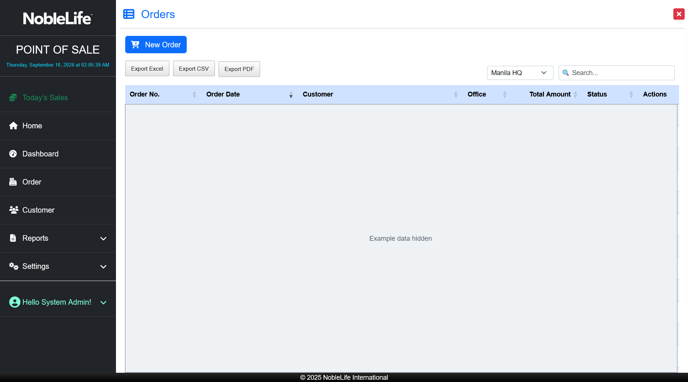
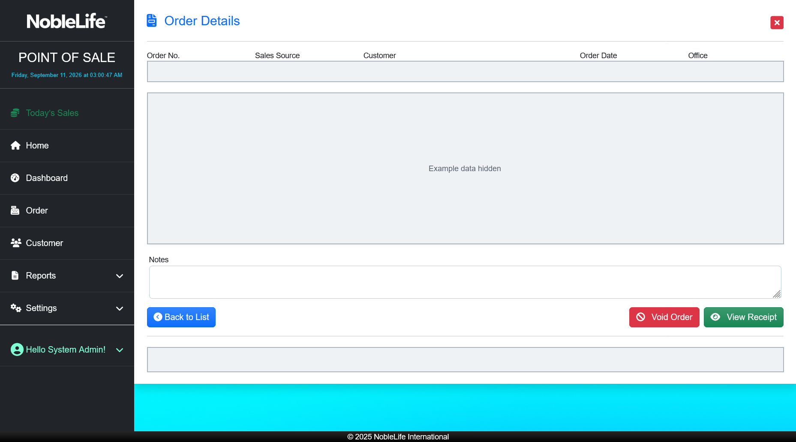
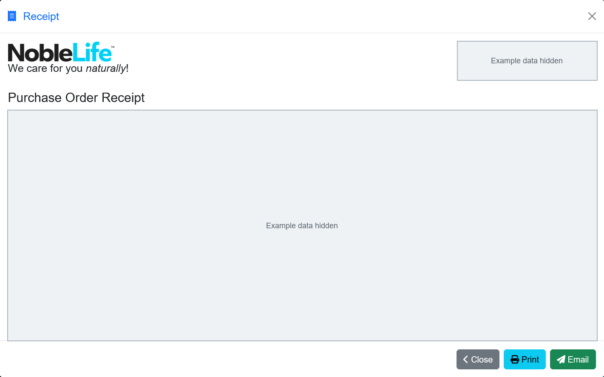

# Receipts

You can open a receipt from an order's details, print it through your browser, or email it when the email action is available.

## Open and print a receipt

1. Select **Order** and find the order in the Orders list. Use the office filter or search field if needed. **Expected result:** The matching order appears in the list.
2. Open the order's details. **Expected result:** Order Details shows the customer, items, totals, and payment summary.
3. Select **View Receipt**. **Expected result:** The receipt opens in a separate window.
4. Select **Print**. **Expected result:** Your browser's print dialog opens.
5. Choose an available printer and print settings, then confirm printing. **Expected result:** The browser sends the receipt to the selected printer.

Figure: Find a saved order in the Orders list; customer and transaction details are concealed.

Figure: Review a saved order before opening its receipt; customer and transaction details are concealed.

## Reprint a receipt

1. Find and reopen the saved, non-void order.
2. Select **View Receipt**, then **Print**. **Expected result:** The receipt is ready to print again.

## Email a receipt

1. Open the order details and select **View Receipt**.
2. Select **Email**, enter the recipient's email address when prompted, and confirm. **Expected result:** The page reports whether the email was sent.

If receipt email reports an error, check the address and ask your administrator whether email service is available. Use **Print** if you need a paper copy.

The application does not provide a receipt-format or printer-setup page. Printing uses the browser's print dialog.

Figure: Open a saved order's receipt to print or email it; purchase details are concealed.
