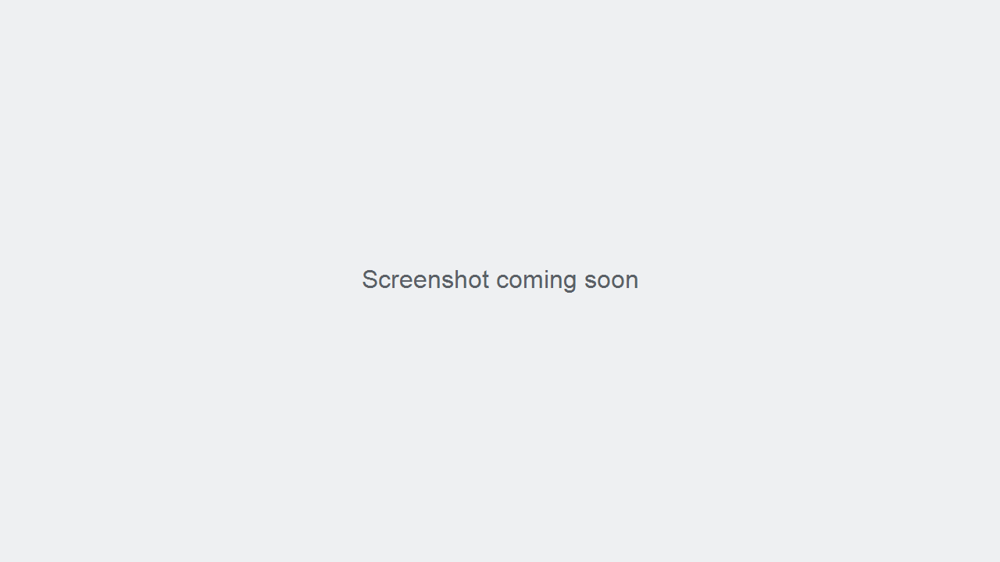

# Holding and Recalling Transactions

NLI-POS does not include a **Hold** action, a **Recall** action, or a list of held orders.

## If checkout cannot be completed

1. Do not leave an unfinished order open expecting another cashier or shift to retrieve it. **Expected result:** You do not rely on NLI-POS to save a held transaction.
2. Follow your store's procedure for an interrupted checkout. **Expected result:** Staff know how to resume or restart the checkout outside a held-orders feature.
3. If you have already placed the order and need to correct it, ask an authorized manager or administrator to review the order and available **Void Order** action. **Expected result:** The team follows the store's correction process without relying on a held-order feature.

<!-- TODO-SCREENSHOT: held-orders-list.png -->

Figure: NLI-POS does not have a held-transactions list (screenshot to be added)
