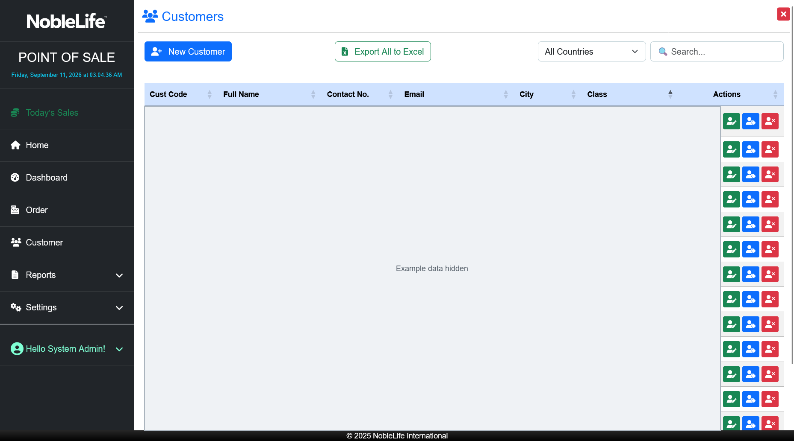
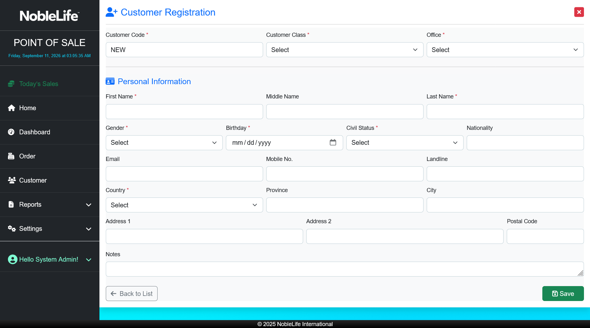
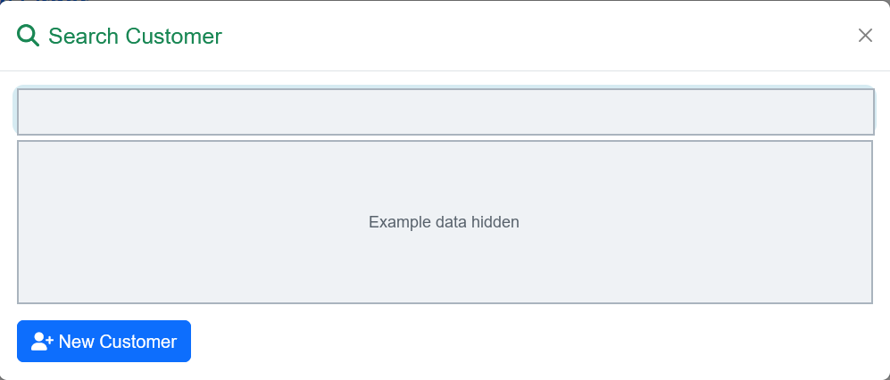

# Customers

Use **Customer** to search for a customer, review their profile, or register a new customer.

## Find a customer

1. Select **Customer** in the navigation. **Expected result:** The Customers list opens.
2. Enter a name or other search text in **Search...**, or choose a country filter. **Expected result:** The list narrows to matching records.
3. Open the customer's details. **Expected result:** The customer profile appears.
4. Choose **Customer Information** or **Order History** to review the profile or recorded orders.

Figure: Search or filter customers from the Customers list; personal records are concealed.

<!-- TODO-SCREENSHOT: customer-profile-and-order-history.png -->

Figure: Review customer information and the orders recorded for that customer (screenshot to be added)

## Register a customer

1. In **Customer**, select **New Customer**. **Expected result:** Customer Registration opens.
2. Choose **Customer Class** and **Office**. **Expected result:** The customer is associated with the right class and office.
3. Enter the required **First Name**, **Last Name**, **Gender**, **Birthday**, and **Civil Status**. **Expected result:** The required personal information is complete.
4. Choose **Country** and enter any available contact or address details. **Expected result:** The contact and address information is ready to save.
5. Select **Save**. **Expected result:** The customer is saved and can be selected for an order.

Figure: Complete the required identity, customer class, office, and country fields.

During checkout, you can also open **Search Customer** and select **New Customer**. Search by name, customer ID, email, or mobile number to find an existing record.

Figure: Search for an existing customer before creating a new record; personal details are concealed.

Use the edit and details actions on the customer list to maintain a profile. Deletion availability depends on the access assigned to your account.
