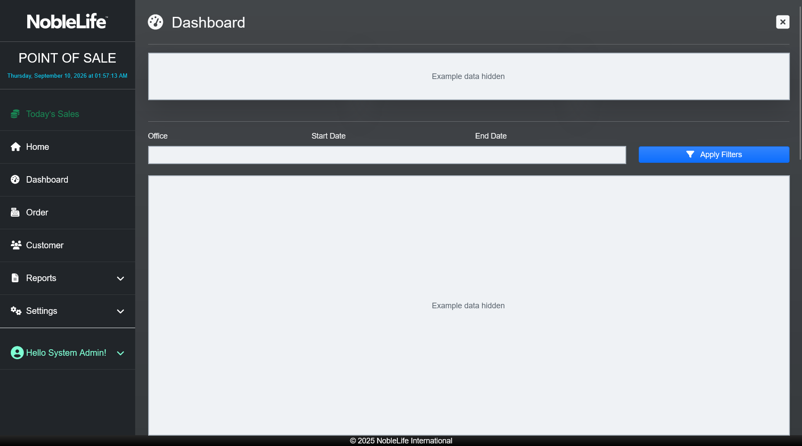
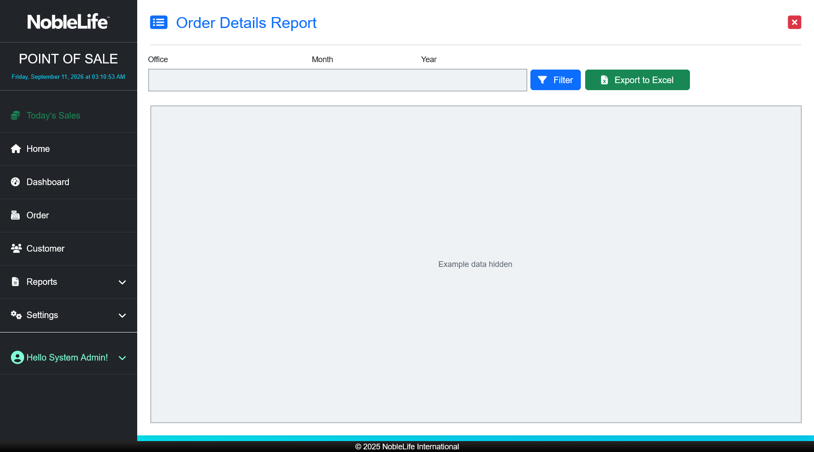

# Reports and Reading Them

Reports help you review recorded sales and salesperson targets. Choose the correct **Office** and reporting period before comparing results. A report with no rows may have no matching activity or the wrong filters.

## Dashboard

The **Dashboard** shows total sales, order count, average order value, and charts for sales trends, products, salespeople, customers, staff purchases, and payment methods. Choose **Office**, **Start Date**, and **End Date**, then select **Apply Filters**. Use chart controls where shown to change the category or comparison period.

Figure: Review sales indicators and charts; live sales and employee data are concealed.

## Daily Sales

1. Open **Reports** > **Daily Sales**. **Expected result:** The Daily Sales report opens.
2. Choose an **Office** and **Date**. **Expected result:** The report is set to the period you want to review.
3. Select **Filter**. **Expected result:** The report shows order and product detail rows for that date.
4. Review the order number, customer, product, quantity, payment method, and reference information. Compare the totals at the bottom of the table.

<!-- TODO-SCREENSHOT: daily-sales-report.png -->

Figure: Filter Daily Sales by office and date, then review the matching sales lines (screenshot to be added)

## Sales by Date Range

1. Open **Reports** > **Sales by Date Range**. **Expected result:** The report opens.
2. Choose an **Office**, **Date From**, and **Date To**. **Expected result:** The report is set to the selected office and date range.
3. Select **Filter**. **Expected result:** The report shows sales lines in the selected period.
4. Review the order, customer, product, quantity, amount, payment, and encoding columns.

<!-- TODO-SCREENSHOT: sales-by-date-range.png -->

Figure: Review order and payment details for the selected office and date range (screenshot to be added)

## Monthly Sales

1. Open **Reports** > **Monthly Sales**. **Expected result:** The Monthly Sales report opens.
2. Choose an **Office**, **Month**, and **Year**. **Expected result:** The report is set to the selected month and year.
3. Select **Filter**. **Expected result:** The monthly sales report displays the selected period.
4. Select **Export to Excel** to download the displayed report when needed.

<!-- TODO-SCREENSHOT: monthly-sales-report.png -->

Figure: Choose the office, month, and year before reviewing or exporting Monthly Sales (screenshot to be added)

## Order Details

1. Open **Reports** > **Order Details**. **Expected result:** The Order Details report opens.
2. Choose an **Office**, **Month**, and **Year**, then select **Filter**. **Expected result:** **Purchases** lists orders for the selected period.
3. Select an order in **Purchases**. **Expected result:** **Details** shows the customer, date, remarks, products, quantities, and total.
4. Select **Export to Excel** to download the filtered report.

Figure: Select a purchase to review the order and its line items; live records are concealed.

## Sales Quota

1. Open **Reports** > **Sales Quota** and choose an **Office**. **Expected result:** The quota list is filtered to the selected office.
2. Select **Add Sales Quota** or the edit action beside a quota. **Expected result:** The quota form opens.
3. Choose the **Salesperson** and **Year and Month**, then enter the **Quota Amount**. **Expected result:** The quota target is ready to save for that salesperson and period.
4. Select **Save Quota**. **Expected result:** The list shows month-to-date sales, quota amount, variance, and achieved percentage.

<!-- TODO-SCREENSHOT: sales-quota-report.png -->

Figure: Compare each salesperson's month-to-date sales with the quota (screenshot to be added)

There is no separate end-of-day cash drawer or shift-close report. **Daily Sales** shows sales recorded in NLI-POS; use your store's cash-count procedure to reconcile a drawer.
